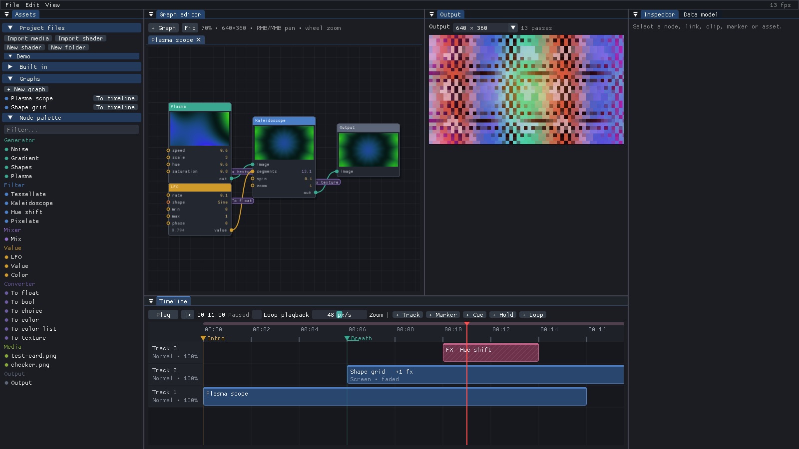

# Tessera

Node-based VJing interface: patch shader graphs, sequence them on a timeline,
composite the result live. C++20 · Dear ImGui (docking) · OpenGL 3.3.



This is a prototype of the architecture described in [`docs/tessera-architecture.md`](docs/tessera-architecture.md)
and its three diagrams (overview, data model, runtime). It starts on a demo
project: two graphs, a content clip with an effect, a hue-shift effect clip,
markers, a hold point and a loop.

## Building

Requirements: CMake ≥ 3.20, a C++20 compiler (GCC 10+, Clang 12+, MSVC 2019 16.10+,
MinGW-w64 with GCC 10+), Git, and network access the first time (CMake fetches
the dependencies).

```sh
cmake -S . -B build -DCMAKE_BUILD_TYPE=Release
cmake --build build -j
./build/tessera          # build\tessera.exe on Windows
ctest --test-dir build   # model tests (no window needed)
```

Linux needs the X11/GL headers for GLFW (Debian/Ubuntu:
`libx11-dev libxrandr-dev libxinerama-dev libxcursor-dev libxi-dev libgl-dev`).
Without the Wayland tools, add `-DGLFW_BUILD_WAYLAND=OFF`.

Command-line options: `--open <project dir>`, `--time <seconds>`, `--play`, and
`--screenshot <file.png> [--frames <n>]` to render a few frames and save the
window (handy for CI or bug reports).

### Libraries

| Library | Use | How it's added |
|---|---|---|
| [GLFW 3.4](https://github.com/glfw/glfw) | window, input, GL context | FetchContent |
| [Dear ImGui 1.93 (docking)](https://github.com/ocornut/imgui) | all of the UI | FetchContent, pinned to `v1.93.0-docking` |
| [glad](https://glad.dav1d.de/) | OpenGL loader | `third_party/glad` (already in the repo) |
| [stduuid](https://github.com/mariusbancila/stduuid) | `uuid` for every entity | `third_party/stduuid` (already in the repo) |
| [nlohmann/json 3.12](https://github.com/nlohmann/json) | `.tsh` headers, project files, data model view | FetchContent |
| [stb_image / stb_image_write](https://github.com/nothings/stb) | image media, screenshots | FetchContent (pinned commit) |

The rendering is plain OpenGL 3.3 core. Everything is fullscreen-quad shader passes into
FBOs, so no 3D engine is needed. If 3D scenes become a node type later, the
runtime can host them as another node kind that renders into its FBO.

## Code map

The code follows the layers of the architecture: the UI edits the model, the
runtime only reads it, and both key their own state by the model's uuids.

```
src/
  core/      Uid (stduuid), colour maths
  model/     pure data: no GL, no ImGui headers
    Model.h          every entity of tessera-02-data-model as a record + Table<T>,
                     the uid → object registry (Model::kindOf)
    Params.h         parameter types, Value (std::variant), ParamDecl, ParamModule
    ParamModules.h   one module per type (float, choice, bool, color, colorList,
                     texture, label, any)
    ShaderFormat.*   .tsh parser (JSON header + GLSL), stdlib, #line mapping
    Builtins.*       built-in shaders (Noise, Gradient, Shapes, Plasma, Tessellate,
                     Kaleidoscope, Hue shift, Pixelate, Mix), media, converters,
                     LFO / Value / Color / Output
    Declarations.*   resolves a parameter's declaration through its owner
    Operations.*     create, link (converter choice, loop refusal), delete
                     (cascades), shader recompile + parameter sync, timeline ops
    Serialize.*      JSON of records/tables, references to and from a uid
  editor/    editor state (positions, views, selection, playhead…),
             History (snapshot per commit, undo/redo), save/load/import, demo
  runtime/   OpenGL: programs keyed by Shader uid, FBOs ("n:"/"l:"/"cn:" + uid,
             accA/accB, fx0/fx1, adj, clipsrc), graph evaluator, converters
             (incl. the 8×8 texture → value readback), compositor, media
             textures, playback (hold points, loops, cue points)
  ui/        App (frame loop, menus, shortcuts, dock layout) and the panels:
             Assets, Graph editor, Inspector (+ shader editor), Data model,
             Output, Timeline; ParamWidgets = the ImGui half of each module
tests/       model tests (linking, cascades, recompile, JSON, save/load,
             undo, playback)
```

A project saves as a folder: `project.tessera` (model + node positions, JSON)
plus the project files (user shaders, copied images) at their relative paths.

## Using it

- **Assets**: import media or shaders, create shaders and folders (new files
  land in the selected folder), built-ins, graphs (+ *To timeline*), node
  palette. Drag any item into a graph or onto the timeline; double-click adds
  it to the open graph.
- **Graph editor**: drag between ports to link (the converter shows on the
  link; click it for its settings), drag from a linked input to re-route it.
  Drag a value on a node to scrub it (Shift: fine, Alt: past the range); click
  bools and choices to change them. Double-click the canvas for quick-add.
  Right/middle drag pans, the wheel zooms, *Fit* frames the graph.
- **Timeline**: drop graphs or media for content clips. A filter shader on
  empty space makes an effect clip, and on a content clip it adds an Effect.
  Drag clips, resize them by their edges, move markers and loop ends (snaps to
  0.25 s, Alt disables). Click or drag the ruler to scrub. The wheel scrolls,
  Ctrl+wheel zooms.
- **Inspector**: every selected entity. For a shader: the code editor,
  *Compile* / Ctrl+Enter, errors with `.tsh` line numbers, *Copy into project*
  for built-ins.
- **Shortcuts**: Space play/pause · Delete remove selection · Ctrl+Z / Ctrl+Shift+Z
  undo/redo · Ctrl+Enter compile shader · Ctrl+S save · Ctrl+O open.

## Not in the prototype yet

- **Video and audio decoding.** Video/Audio rows, nodes and clips exist, but
  they render a striped placeholder and an audio level of 0. Suggested:
  [FFmpeg](https://ffmpeg.org/) (libavformat/libavcodec) for video and
  [miniaudio](https://github.com/mackron/miniaudio) for playback and analysis.
- **Native file dialogs.** A small ImGui browser is used instead.
  [nativefiledialog-extended](https://github.com/btzy/nativefiledialog-extended)
  would be a drop-in replacement.
- **Code editor.** It is a plain multiline text field.
  [ImGuiColorTextEdit](https://github.com/santaclose/ImGuiColorTextEdit) adds
  syntax highlighting and inline error markers.
- **Asynchronous readback.** Texture → value still uses a synchronous
  `glReadPixels`. Pixel buffer objects are the planned fix (architecture §9).
- The open decisions in architecture §9 are kept as they are documented. For
  example, Node positions live in editor state, and the first Loop is the active one.
