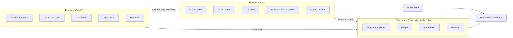
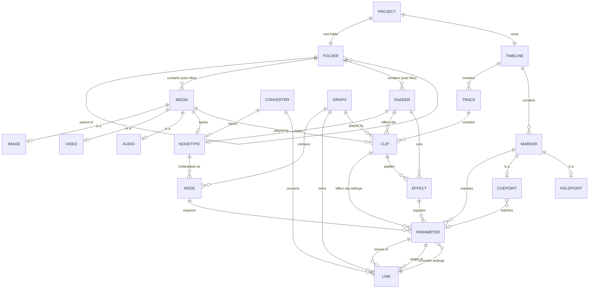
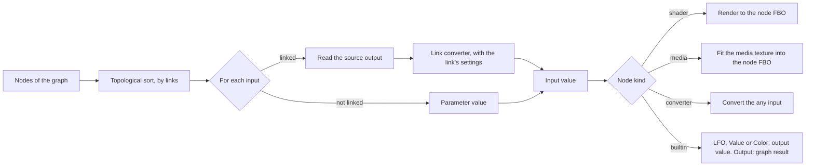
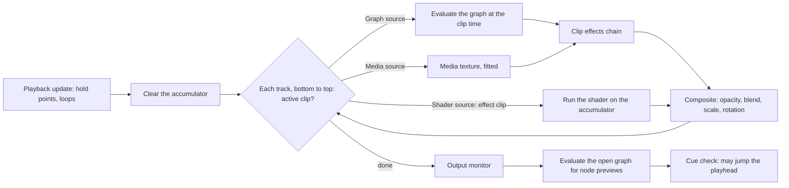
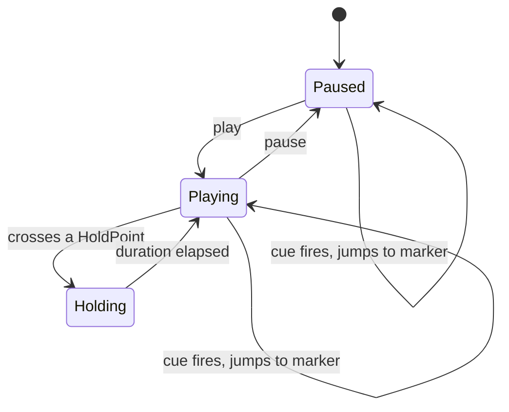

# Tessera — Architecture

Node-based VJing interface. Target stack: **C++ / ImGui / OpenGL**. The web prototype mirrors this split with WebGL2 and the DOM.

This document describes the architecture as it stands after the prototype iterations. It has the following parts:

0. Overview
1. Principles
2. Layers
3. Data model
4. Parameters
5. Converters
6. Shader format
7. Runtime
8. User interface
9. Open decisions

The companion graphics are:

- `tessera-01-overview.svg`: layers and domains
- `tessera-02-data-model.svg`: every entity, its fields and its references
- `tessera-03-runtime.svg`: what happens on each frame

The Mermaid diagrams below render on GitHub, GitLab and in most Markdown viewers.

---

## 0. Overview



---

## 1. Principles

- **Layered code.** The data model, the runtime and the UI are separate. The UI reads and edits the model. The runtime only reads it.
- **Pure data model.** Model objects hold no OpenGL resources. Textures, FBOs and compiled programs live in the runtime, keyed by the same uuids.
- **uuid everywhere.** Every entity has a `uuid uid`. References between entities are uuids, never pointers, so the model can be saved, loaded and undone as one value.
- **Child stores its parent.** A child holds its parent's uid (`graphUid`, `trackUid`, `timelineUid`, `folderUid`, `parentUid`…).
- **Type / instance split.** Shared definitions (`NodeType`, `Converter`, `Shader`) are separate from the instances placed in a project (`Node`, `Link`, `Effect`, `Clip`). An instance's parameter declarations are resolved through its definition.
- **Polymorphic references.** `Parameter.ownerUid`, `Effect.ownerUid`, `Clip.sourceUid` and `NodeType.backingUid` can point to different kinds of object. A global **uuid → object registry** resolves them and reports the kind.
- **"Is a" subtypes share the parent's uid.** `Image`, `Video` and `Audio` rows use the uid of their `Media` row. `CuePoint` and `HoldPoint` rows use the uid of their `Marker` row.
- **Folders are for the user's files only.** Built-in shaders and media ship with the app under `tessera://` and have `folderUid = null`.

---

## 2. Layers

| Layer | Holds | Rules |
|---|---|---|
| **Data model** | Flat tables of records, one table per entity, keyed by uid | No GPU objects, no pointers. Serialisable as is. |
| **Runtime** | Compiled shader programs, FBOs, media textures, evaluated values | Keyed by model uids. Rebuilt or garbage-collected when the model changes. Never written back into the model. |
| **UI** | Panels, widgets, drag and drop | Edits the model through operations (create, link, delete…), then commits. |
| **Editor state** | Node positions, graph view pan and zoom, selection, playhead, loop toggle, timeline zoom | Not part of the model. Node positions are saved with the project. |
| **Persistence and undo** | Snapshots of model + node positions + project files | Each commit pushes a snapshot. Undo and redo restore a snapshot. |

---

## 3. Data model

### 3.1 Domains

| Domain | Entities | Role |
|---|---|---|
| Project and Assets | Project, Folder, Media (Image, Video, Audio), Shader | The project root, and the files it uses |
| Graph | Graph, NodeType, Node, Link, Converter | Node-based patching |
| Parameters | Parameter | Every editable or linkable value |
| Timeline | Timeline, Track, Clip, Effect, Marker (CuePoint, HoldPoint), Loop | Editing-style sequencing of graphs, media and effects |

### 3.2 Relationships



`Loop` is not attached to anything yet (see section 9).

### 3.3 Project and Assets

**Project**

| Type | Field | Notes |
|---|---|---|
| uuid | uid | |
| string | name | |
| uuid | rootFolderUid | → Folder |
| uuid | timelineUid | → Timeline |

- This is the project root, which was an open decision in the first version of the model.

**Folder**

| Type | Field | Notes |
|---|---|---|
| uuid | uid | |
| string | label | |
| string | localPath | Relative to the project, `.` for the root |
| uuid | parentUid | → Folder, `null` for the root |

- A Folder represents the file architecture of the **user's imports**: imported media, imported shaders, shaders created in the app, and sub-folders.
- New files land in the selected folder.

**Media**

| Type | Field | Notes |
|---|---|---|
| uuid | uid | |
| string | path | `tessera://media/…` for built-ins |
| uuid | folderUid | → Folder, `null` for built-ins |

- **Image** `{uid, width, height}`, **Video** `{uid, duration}` and **Audio** `{uid, duration}` are kinds of Media that share its uid.
- A Media file backs one NodeType. It can also be played by a Clip.
- In the prototype, images under 1.5 MB are copied into the project. Video and audio stay external references and need relinking after a reload.

**Shader**

| Type | Field | Notes |
|---|---|---|
| uuid | uid | |
| string | label | Read from the shader header |
| string | path | `tessera://shaders/…` for built-ins |
| uuid | folderUid | → Folder, `null` for built-ins |

- A Shader is written in Tessera's shader format (section 6).
- It backs one NodeType. It is used by Effects, and it can be the source of an effect Clip.
- Built-in shaders are read-only. "Copy into project" duplicates one into a folder so it can be edited.

### 3.4 Graph

**Graph**

| Type | Field | Notes |
|---|---|---|
| uuid | uid | |
| string | name | |
| vec2 | resolution | Size of its node FBOs |

- A Graph contains Nodes and owns Links. Links are specific to one graph.
- It can be played by a Clip.

**NodeType** (the definition)

| Type | Field | Notes |
|---|---|---|
| uuid | uid | |
| string | label | |
| string | category | Generator, Filter, Mixer, Value, Converter, Media, Output |
| string | kind | `shader`, `media`, `converter` or `builtin` |
| uuid | backingUid | → Shader, Media or Converter, `null` for built-ins |

- A NodeType declares the node's inputs and outputs. For a shader, they come from the shader header. For a converter, they are an `any` input, the converter settings, and one output.
- The built-in types are LFO, Value, Color and Output.
- The node palette is the list of NodeTypes.

**Node** (the instance)

| Type | Field | Notes |
|---|---|---|
| uuid | uid | |
| uuid | graphUid | → Graph |
| uuid | typeUid | → NodeType |

- A Node is one placement of a NodeType in a Graph. It owns its Parameter values.
- Its position is kept in editor state, not in the model.

**Link**

| Type | Field | Notes |
|---|---|---|
| uuid | uid | |
| uuid | sourceParam | → Parameter, an output |
| uuid | targetParam | → Parameter, an input |
| uuid | converterUid | → Converter, always set |
| uuid | graphUid | → Graph |

- A Link connects two Parameters of different nodes in the same graph.
- **Every link runs through a converter.** The converter is the one for the input's type, or for the source's type when the input is `any`.
- The converter's settings are Parameters owned by the Link.
- Links are rejected if they would create a loop.

**Converter**

| Type | Field | Notes |
|---|---|---|
| uuid | uid | |
| string | label | `To float`, `To color`… |
| string | fromType | Always `any` |
| string | toType | One per parameter type |

- A Converter can back a NodeType, which gives a converter node. See section 5.

### 3.5 Parameters

**Parameter**

| Type | Field | Notes |
|---|---|---|
| uuid | uid | |
| uuid | ownerUid | → Node, Link, Clip, Effect or Marker |
| string | name | |
| string | type | See section 4 |
| string | direction | `in` or `out` |
| variant | value | `std::variant` in C++. Textures are runtime handles, never stored. |
| bool | linkable | `false` for labels and for settings outside graphs |

- **Who owns parameters:**
  - Node: its declared inputs and outputs.
  - Link: its converter settings.
  - Clip: the shader inputs, when the clip is an effect clip.
  - Effect: its shader inputs, except the `image` input.
  - Marker: its label.
- **Where a parameter's declaration comes from** (range, options, default): it is resolved through the owner. A Node goes through its NodeType, a Link through its Converter, a Clip or an Effect through its Shader.
- **Live values:**
  - Computed outputs (an LFO value, for example) and linked inputs are runtime values. They are not written back into `value`.
  - The UI displays the runtime value when there is one.

### 3.6 Timeline

**Timeline**

| Type | Field |
|---|---|
| uuid | uid |

- A Timeline contains Tracks and Markers.

**Track**

| Type | Field | Notes |
|---|---|---|
| uuid | uid | |
| int | order | A higher order is drawn on top |
| float | opacity | |
| BlendMode | blendMode | Normal, Add, Multiply, Screen, Difference |
| uuid | timelineUid | → Timeline |

**Clip**

| Type | Field | Notes |
|---|---|---|
| uuid | uid | |
| uuid | sourceUid | → Graph, Media or **Shader** |
| float | start | Seconds |
| float | duration | Seconds |
| string | startMode | `From clip start` or `Continuous` |
| BlendMode | blendMode | Overrides the track's mode when it isn't Normal |
| float | opacity | |
| float | speed | |
| float | scale | |
| float | rotation | Degrees |
| uuid | trackUid | → Track |

- **Content clip** (the source is a Graph or Media): it renders its source. Then it runs its Effects chain, then it is composited onto the tracks below.
- **Effect clip** (the source is a filter Shader): it processes the composite of every track below it while the playhead is inside it, like an adjustment layer. A higher track affects more layers. Its shader inputs are Parameters owned by the Clip.
- **Drag and drop:** a filter shader dropped on empty track space creates an effect clip. Dropped on a content clip, it adds an Effect to that clip.

**Effect**

| Type | Field | Notes |
|---|---|---|
| uuid | uid | |
| uuid | shaderUid | → Shader, which must have a single `image` texture input |
| int | order | Position in the chain |
| uuid | ownerUid | → Clip |

- An Effect is a shader-based instance, distinct from nodes. Its Parameters are owned by the Effect.

**Marker**

| Type | Field | Notes |
|---|---|---|
| uuid | uid | |
| float | position | Seconds |
| uuid | timelineUid | → Timeline |

- A Marker is a point on the timeline. It exposes a `label` Parameter.
- **CuePoint** `{uid, parameterUid, condition}` and **HoldPoint** `{uid, duration}` are kinds of Marker that share its uid.
  - A CuePoint watches a Parameter. When the value rises above `condition`, it jumps the playhead to the marker. It fires while paused too, which makes it a live trigger.
  - A HoldPoint pauses playback for `duration`, then playback continues.

**Loop**

| Type | Field |
|---|---|
| uuid | uid |
| float | start |
| float | end |

- When loop playback is on, the playhead jumps back to `start` when it reaches `end`.

---

## 4. Parameters and parameter modules

Each parameter type is a reusable **module**. A module knows how to store its value, draw its ImGui widget, save and load it, and what it accepts.

| Type | Value | Widget | Shader uniform |
|---|---|---|---|
| `float` | number | Slider and number field. Scrubbable on the node. | `uniform float` |
| `choice` | index | Dropdown | `uniform int` |
| `bool` | bool | Toggle | `uniform bool` |
| `color` | `#rrggbb` | Color picker | `uniform vec3` |
| `colorList` | up to 4 colors | Row of pickers with add and remove | `uniform vec3 x[4]` plus `int x_count` |
| `texture` | runtime handle | Port only | `uniform sampler2D` |
| `label` | string | Read-only text, or a text field on markers | none, never linkable |
| `any` | whatever is linked | Port only (converter node input) | none |

The same modules are used on the nodes, in the inspector, for Effect, effect-Clip and Link settings, and for Clip fields.

---

## 5. Converters

There is one Converter per parameter type. Each one accepts **any** source type and produces its own type. Every Link has one, chosen from the input's type.

| Converter | From each source type | Settings (owned by the Link) |
|---|---|---|
| **To float** | The source is reduced to a number: brightness for a color or image, index for a choice. Then `inMin–inMax` is mapped to `outMin–outMax`. | inMin, inMax, outMin, outMax |
| **To bool** | The number is compared to the threshold. | threshold, invert |
| **To choice** | `Spread` maps 0–1 across the target's options. `Index` uses the number as an index (the default from choice to choice). | mode, offset |
| **To color** | Colors and images pass through with a hue shift. Numbers become a hue or a brightness. Then the result is multiplied by the tint. | mode, hueShift, saturation, tint |
| **To color list** | A color or a number is spread around the hue wheel. An image is sampled across its middle. A list is resized. | count, spread, hueShift |
| **To texture** | Images pass through, and are skipped when the gain is 1. Numbers and colors fill the frame. A list becomes a gradient. | gain |

- **Texture to value.** An image is reduced to an 8×8 GPU readback per frame: its average color, its brightness and four samples. The readback stalls the GPU, so it should be kept for the links that need it.
- **Converter nodes.** A converter node has an `any` input, its settings as inputs, and one output of its type. A link into the `any` input uses the converter of the source's type, which passes the value through.

---

## 6. Shader format (`.tsh`)

A shader file is a JSON header in a comment, followed by GLSL that defines `vec4 render(vec2 uv)`, which returns premultiplied RGBA.

```glsl
/* @tessera {
  "label": "Hue shift", "category": "Filter",
  "inputs": [
    {"name": "image", "type": "texture"},
    {"name": "hue", "type": "float", "default": 0, "min": 0, "max": 1}
  ]
} */
vec4 render(vec2 uv){
  vec4 c = texture(image, uv);
  vec3 hsv = rgb2hsv(c.a > 0. ? c.rgb / c.a : vec3(0.));
  hsv.x = fract(hsv.x + hue);
  return vec4(hsv2rgb(hsv) * c.a, c.a);
}
```

- **Uniforms** are generated from `inputs`. `TIME` and `RES` are always available.
- **The standard library** provides `hash21`, `hash22`, `vnoise`, `fbm`, `hsv2rgb` and `rgb2hsv`.
- **The role is inferred from the inputs:**
  - No texture input: **generator**.
  - Exactly one texture input named `image`: **filter**, usable as an Effect or an effect clip.
  - Several texture inputs: **mixer**.
- **Compile errors** report line numbers in the `.tsh` file, using `#line`.
- **Recompiling** updates the NodeType's label and category. It also syncs the parameters of every Node, Effect and effect Clip that uses the shader, keeping existing values.

**Built-in shaders:**

| Category | Shaders |
|---|---|
| Generators | Noise, Gradient, Shapes, Plasma |
| Filters | Tessellate, Kaleidoscope, Hue shift, Pixelate |
| Mixer | Mix |

---

## 7. Runtime

### 7.1 Resources (keyed by model uids)

| Resource | Key |
|---|---|
| Compiled program | Shader uid. Recompiled when the source changes. |
| Node output FBO | `n` + node uid, at the graph's resolution |
| Converter output FBO (`To texture`) | `l` + link uid, or `cn` + converter node uid |
| Compositing | `accA` / `accB` (ping-pong accumulator), `fx0` / `fx1` (clip effect chain), `adj` (effect clip), `clipsrc` (media fit) |
| Media | Texture per Media uid. Video is re-uploaded each frame, audio goes through an analyser. |
| Live values | Output values and linked input values per Parameter uid |

FBOs whose node or link no longer exists are released after each commit.

### 7.2 Graph evaluation



### 7.3 Frame loop and compositing



- **Clip time** is `(t − start) × speed`, or `t × speed` when the start mode is `Continuous`.
- **Blend mode:** a clip's own mode wins when it isn't Normal. Otherwise the track's mode applies. The opacity used is clip opacity × track opacity.

### 7.4 Playback states



---

## 8. User interface

| Panel | Does |
|---|---|
| **Assets** | **Project files** is the user's folder tree, with import media, import shader, new shader and new folder. **Built in** lists the app's shaders and media. **Graphs** lists the graphs, with a button to add one to the timeline. **Node palette** lists NodeTypes by category. Items can be dragged into a graph or onto the timeline. |
| **Graph editor** | One tab per graph, with pan, zoom and fit. Nodes show a live preview and their parameter values. Dragging between ports creates a link, and dragging from a linked input re-routes it. Every link shows its converter. Double-click opens quick-add. |
| **Output monitor** | Shows the composited timeline at the playhead. |
| **Inspector** | Edits the selected entity with the parameter modules. Shaders open in a code editor with compile errors. |
| **Data model view** | Shows the raw tables, the selected record, what it points to and what references it, and the project as JSON. |
| **Timeline** | Tracks with clips (graph, media or effect), markers, cue points, hold points and loops. Supports scrubbing, snapping to 0.25 s and zoom. |

**Shortcuts:** `Space` plays and pauses, `Delete` removes the selection, `Ctrl+Z` undoes and `Ctrl+Shift+Z` redoes, `Ctrl+Enter` compiles a shader.

---

## 9. Open decisions

### Resolved during prototyping

- **Project root:** added `Project {name, rootFolderUid, timelineUid}`.
- **Folders:** only for the user's files. Built-ins are under `tessera://` with `folderUid = null`.
- **Effects on the whole render:** effect shaders are clips on tracks, and they apply to everything below them in time and in stacking.
- **Converters:** one per type, from any type, on every link, with per-link settings as Parameters.
- **Clip sources:** `Clip.sourceUid` can point to a Shader (effect clip).

### Still open

- **Node position:** it is in editor state for now. Decide whether it belongs in the saved model, for example as `Node.pos`.
- **Built-in vs project:** "built-in" is inferred from the `tessera://` prefix. An explicit `origin` field, or an app Library entity, would be clearer.
- **Shader role:** generator, filter or mixer is inferred from the texture inputs. A `role` field would make it explicit, and would let **Generators** become clip sources the same way effect clips do.
- **`Link.converterUid`:** it can be derived from the input type. Either drop it and keep only the per-link settings, or keep it to allow several converters per type later.
- **NodeType kind `builtin`:** LFO, Value, Color and Output have `backingUid = null`. Decide whether built-in behaviours need their own table.
- **Clip fields vs Parameters:** `opacity`, `speed`, `scale`, `rotation` and `blendMode` are Clip fields. Linkable ones should become Parameters.
- **Linking outside graphs:** Clip, Effect, Marker and Link-setting parameters are not linkable yet.
- **CuePoint condition:** it is implemented as a rising threshold. A single float can't express "falls below" or "equals".
- **Loop ownership:** Loop has no `timelineUid`, and "loop playback on" is editor state.
- **Track vs Clip blend mode:** with one active clip per track, the two overlap. The current rule is that the clip wins unless it is Normal.
- **Media import:** images are copied into the project, video and audio are external. Decide between copy-all and a "collect media" action.
- **Cue line vs trigger line:** time-based sequencing and live triggers both work through `startMode` and CuePoints. A dedicated trigger line is not modelled yet.
- **Texture to value cost:** the GPU readback stalls the pipeline. It should be limited, or made asynchronous with pixel buffer objects in C++.
